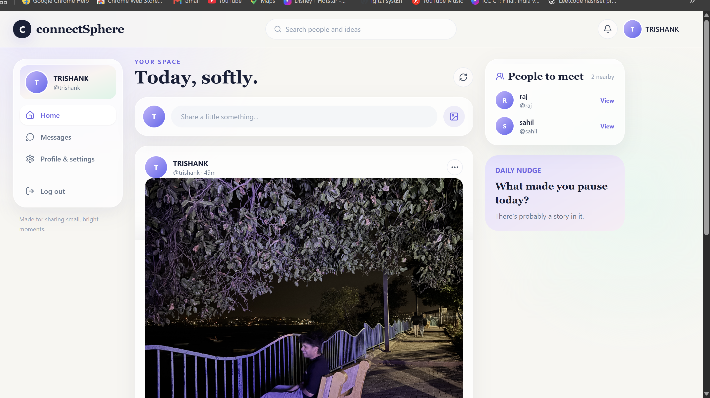
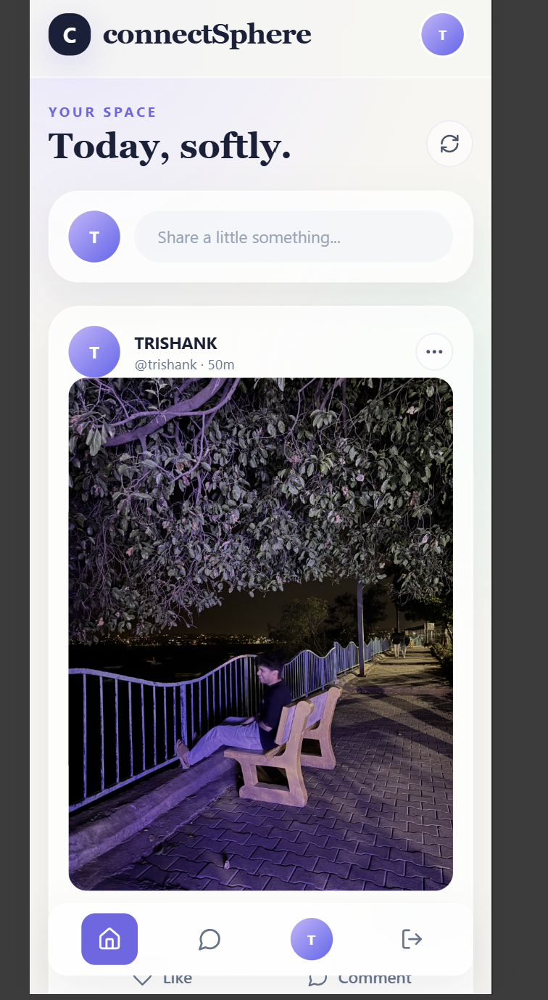
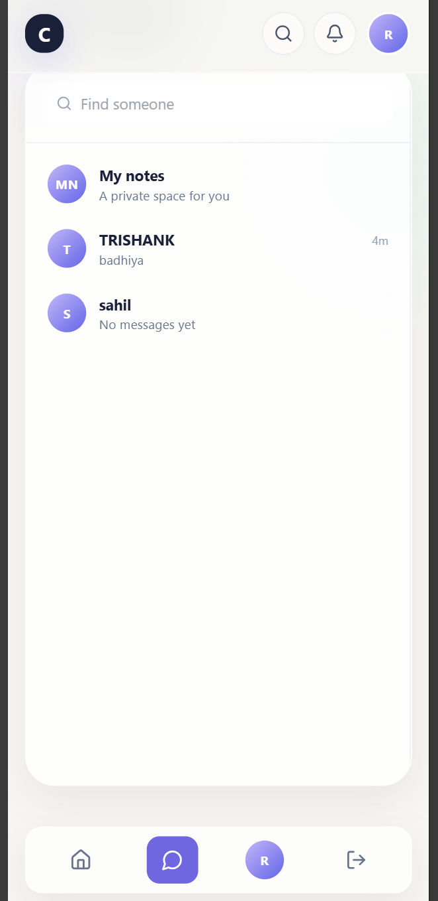

<div align="center">

# connectSphere

### A softer, more personal social space for sharing moments and staying close.


<p>
  <a href="#features">Features</a> •
  <a href="#interface">Interface</a> •
  <a href="#quick-start">Quick start</a> •
  <a href="#project-structure">Structure</a>
</p>

</div>

---

## ✨ What is connectSphere?

connectSphere is a full-stack social platform with an intentionally calm, off-white glass interface. It brings together the familiar things people expect from a social network—posts, reactions, comments, connection requests, profiles, notifications, and private conversations—without making the experience feel heavy.

The project was built as a clean, understandable MERN-style application: a polished React frontend paired with a small Express API, MongoDB models, JWT cookie authentication, and Socket.IO for live updates.

> Share a moment. Find your people. Keep the conversation going.

## 🎯 Features

| Share | Connect | Stay close |
| --- | --- | --- |
| Create photo or text posts | Send and accept connection requests | Live Socket.IO direct messages |
| Like and comment on posts | View profiles and connection lists | Unread message badges and inbox previews |
| Upload a profile photo | Search people from desktop or mobile | In-app activity notifications |
| Edit name, username, bio, and password | Open a profile straight from chat | Last message, sender, time, and unread count in the inbox |

### Authentication and safety

- Six-digit email OTP sign-up
- Login with either username or email
- Password hashing with `bcryptjs`
- JWT stored in an HTTP-only cookie
- Protected API routes and validated image uploads
- Gmail SMTP support using an App Password, with a development OTP fallback in the terminal

## 🖼️ Interface

### Desktop feed



### Responsive mobile experience

<p align="center">
  
  &nbsp;&nbsp;
  
</p>

The UI adapts from a three-column desktop layout to a compact mobile experience with search, notifications, inbox badges, profile access, and logout always within reach.

## 🧰 Tech stack

| Layer | Tools |
| --- | --- |
| Frontend | React 18, Vite, Tailwind CSS, React Router, Axios, Lucide icons |
| Backend | Node.js, Express, Mongoose, Multer, Nodemailer |
| Authentication | JWT, HTTP-only cookies, bcryptjs, email OTP |
| Database | MongoDB |
| Real time | Socket.IO |

## ⚡ Quick start

### 1. Clone and install

```bash
git clone https://github.com/trishank08/connectsphere.git
cd connectsphere

cd backend
npm install

cd ../frontend
npm install
```

### 2. Configure environment variables

Create `backend/.env` from the supplied example:

```env
PORT=5000
MONGODB_URI=mongodb://127.0.0.1:27017/connectsphere
JWT_SECRET=replace_this_with_a_long_random_secret
CLIENT_URL=http://localhost:5173

# Optional: required only when you want Gmail to send OTPs
EMAIL_USER=youraddress@gmail.com
EMAIL_PASS=your_16_character_google_app_password
```

Create `frontend/.env` if you need non-default API URLs:

```env
VITE_API_URL=http://localhost:5000/api
VITE_SOCKET_URL=http://localhost:5000
```

> **No Gmail setup yet?** Leave `EMAIL_USER` and `EMAIL_PASS` empty. The backend prints the OTP in its terminal during local development.

### 3. Start both apps

Open two terminals:

```bash
# Terminal 1
cd backend
npm run dev
```

```bash
# Terminal 2
cd frontend
npm run dev
```

Visit **http://localhost:5173**. The API runs at **http://localhost:5000**.

## 🔄 How the social flow works

```text
Discover a profile
       ↓
Send a connection request
       ↓
Recipient receives a live notification
       ↓
Accept the request → both profiles show the connection
       ↓
Say hello → send a direct message → conversation appears in both inboxes
```

Likes, comments, connection requests, request acceptance, and incoming messages all update the appropriate notification or unread badge in real time.

## 📁 Project structure

```text
connectsphere/
├── frontend/
│   ├── src/
│   │   ├── components/      # App shell, cards, composer, avatar
│   │   ├── context/         # Authentication state
│   │   └── pages/           # Feed, profile, messages, auth
│   └── tailwind.config.js
│
├── backend/
│   ├── src/
│   │   ├── controllers/     # Auth, posts, users, messages, connections, alerts
│   │   ├── middleware/      # JWT protection and Multer upload handling
│   │   ├── models/          # User, Post, Message, Notification, FriendRequest
│   │   ├── routes/          # Express API routes
│   │   └── utils/           # Token, mail, and notification helpers
│   └── uploads/             # Local development image storage
│
└── docs/images/             # Product screenshots used in this README
```

## 🔌 API overview

| Area | Examples |
| --- | --- |
| Auth | `POST /api/auth/send-otp`, `POST /api/auth/verify-signup`, `POST /api/auth/login` |
| Posts | `GET/POST /api/posts`, `PATCH /api/posts/:id/like`, `POST /api/posts/:id/comments` |
| Profile | `GET /api/users/:username`, `PATCH /api/users/me/profile`, `PATCH /api/users/me/password` |
| Messages | `GET /api/messages/contacts`, `GET/POST /api/messages/:userId` |
| Connections | Send, accept, check status, and view a profile's connections |
| Notifications | Fetch, mark read, and retrieve unread notification/message counts |

## 🌱 Next improvements

- Cloudinary or S3 for production image hosting
- Pagination for large feeds and conversations
- Rich comment replies and post saving
- Typing indicators and online presence
- Deployment with managed MongoDB and secure environment variables

---

<div align="center">
  Built with care using React, Tailwind CSS, Express, MongoDB, and Socket.IO.<br />
  <strong>connectSphere — make your moment.</strong>
</div>
